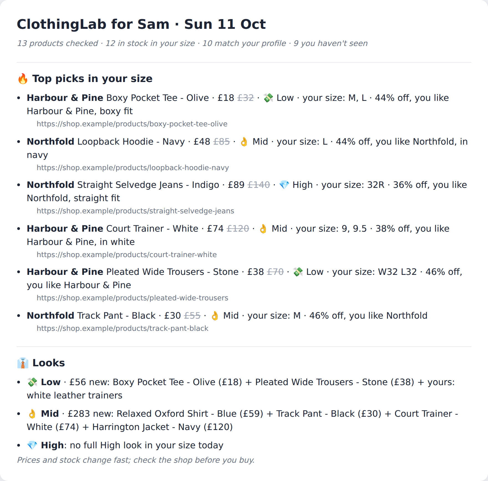
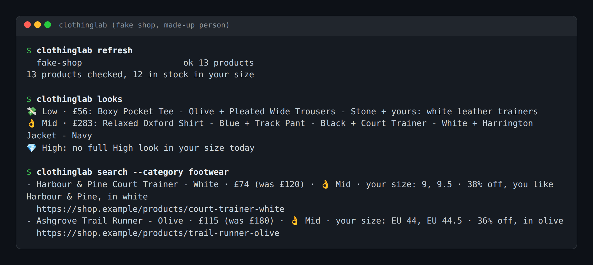
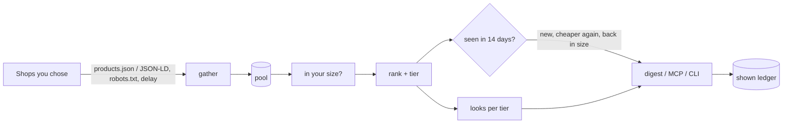

# ClothingLab

Sale clothes that are actually in stock in your size, from shops you choose, with one look per budget tier and nothing shown twice. It's a CLI, an MCP server for your AI assistant, and a daily digest.



*A real digest, generated from the fake shop in `tests/fake_shop.py` for a made-up person ("Sam", tops M/L, waist 32, UK 9/9.5).*

  

## Contents

- [What it does](#what-it-does)
- [Quick start](#quick-start)
- [Usage](#usage)
- [Use it from your AI assistant (MCP)](#use-it-from-your-ai-assistant-mcp)
- [Configuration](#configuration)
- [How it works](#how-it-works)
- [Status, limits and real results](#status-limits-and-real-results)
- [Licence and credits](#licence-and-credits)

## What it does

- **Only shows what's in stock in your size.** It reads each variant's size and stock flag, so a hoodie with only M left never reaches someone who wears L. Items where the shop doesn't publish per-size stock are left out, not guessed.
- **Understands real size labels**: `XX-Large` = `2XL` = `XXL`, `W32 L30`, `32R`, Shopify's glued `44 2/3 / Cream / Blue`, bare EU shoe sizes (worked out from your UK size), and it throws out youth sizes like `6Y` or `5.5 GS`.
- **Budget tiers 💸 Low / 👌 Mid / 💎 High** by plain £ lines per garment (a tee under £25 is Low), which you can move.
- **Never repeats itself.** Anything you've been shown stays out for 14 days, unless it got 5% cheaper again or came back into your size. Colourways count as the same product.
- **Builds one look per tier** from a top, bottom and shoes in your size, using pieces you already own when it helps, and says so when a tier has no full look today.
- **Watches products** for a price drop or a target price.
- **Asks before it assumes.** A short onboarding interview writes your profile. It never asks for height or weight.

## Quick start

You need Python 3.10 or newer.

```bash
pipx install git+https://github.com/casareanderson/clothinglab    # or: pip install -e . from a clone
clothinglab init          # writes ~/.clothinglab/config.yaml and profile.yaml
```

Open `~/.clothinglab/config.yaml`, set `user_agent` to something that identifies you (it refuses to run until you do), and add the shops you buy from. Then:

```bash
clothinglab onboard       # the interview: sizes, fit, colours, brands, budget
clothinglab refresh       # fetch the shops (slow and polite)
clothinglab digest        # today's picks and looks
```

Success looks like `N products checked, M in stock in your size` from `refresh`, and a digest like the one above. The full walk-through, with what to expect at each step, is in [docs/SETUP.md](docs/SETUP.md); a GitHub Action runs that guide on a fresh machine every week.

## Usage



*Real output against the fake shop. The trail runner is listed in EU sizes; ClothingLab matched EU 44 and 44.5 to UK 9 and 9.5.*

| Command | What it does |
|---|---|
| `clothinglab refresh` | Fetch every source and keep the pool |
| `clothinglab picks` | Today's picks you haven't seen, one per tier first |
| `clothinglab search --category footwear --tier low --max-price 60 --query navy` | Ask the pool a question |
| `clothinglab looks` | One look per budget tier |
| `clothinglab digest --mark-shown --out today.md` | The digest; `--mark-shown` records it so tomorrow doesn't repeat |
| `clothinglab digest --discord` / `--email you@example.com` | Send it (webhook / SMTP from environment variables) |
| `clothinglab watch add URL --target 60` / `watch check` | Watch a product |

A daily digest is one cron line: `25 8 * * * clothinglab refresh && clothinglab digest --mark-shown --email you@example.com`.

## Use it from your AI assistant (MCP)

`clothinglab mcp` runs an MCP server on stdio with 10 tools: `clothinglab_questions`, `clothinglab_save_profile`, `clothinglab_profile`, `clothinglab_refresh`, `clothinglab_search`, `clothinglab_todays_picks`, `clothinglab_digest`, `clothinglab_watch_add`, `clothinglab_watch_list`, `clothinglab_watch_check`. A new person can be onboarded entirely in chat.

Claude Desktop (`claude_desktop_config.json`), Cursor (`.cursor/mcp.json`) and most other clients use the same shape:

```json
{
  "mcpServers": {
    "clothinglab": {
      "command": "clothinglab",
      "args": ["mcp"],
      "env": { "CLOTHINGLAB_HOME": "/home/you/.clothinglab" }
    }
  }
}
```

Claude Code: `claude mcp add clothinglab -e CLOTHINGLAB_HOME=$HOME/.clothinglab -- clothinglab mcp`. Pass `CLOTHINGLAB_HOME` explicitly: MCP clients don't hand their own environment to the server. More clients, and the skill file for agents that use skills, are in [docs/MCP.md](docs/MCP.md) and [skills/clothinglab/SKILL.md](skills/clothinglab/SKILL.md).

## Configuration

Two files in `$CLOTHINGLAB_HOME` (default `~/.clothinglab`), both written owner-only.

**`config.yaml`**: where to look. See [clothinglab/examples/config.example.yaml](clothinglab/examples/config.example.yaml).

| Key | Default | What it does |
|---|---|---|
| `user_agent` | placeholder | Who you are, sent to every shop. Must be changed before anything runs |
| `politeness.delay_seconds` | `2` | Gap between requests to the same shop |
| `politeness.timeout_seconds` | `20` | Per request |
| `politeness.allow_private_hosts` | `false` | Only for testing against a shop on your own machine |
| `sources[]` | 4 example UK Shopify shops | `name`, `adapter` (`shopify`, `jsonld` or `module:function`), `url`, optional `collection`, `currency`, `shoe_scale`, `max_pages` |
| `tiers.caps` | built-in table | £ lines per garment: `{tee: {low: 25, high: 80}}` |
| `digest.picks` | `6` | Picks per digest |

**`profile.yaml`**: who you are, written by `clothinglab onboard`. See [clothinglab/examples/profile.example.yaml](clothinglab/examples/profile.example.yaml).

| Key | What it does |
|---|---|
| `sizes.tops` / `bottoms_letter` | Letter sizes, best fit first |
| `sizes.waist` / `trouser_length` | Waist in inches; `short`, `regular` or `long` |
| `sizes.shoes_uk` | UK shoe sizes; EU and US are worked out |
| `fit.likes` / `fit.never` | Fit words that score up / remove an item (`skinny`) |
| `colours.palette` / `avoid` | Colours that score up / remove an item |
| `brands.love` / `never` | Brands that score up / never appear |
| `budget.tiers` / `caps` | Which tiers you want, and your own £ lines |
| `wardrobe` | Pieces you own that looks can use |

**Environment**: `CLOTHINGLAB_HOME`, `CLOTHINGLAB_DISCORD_WEBHOOK`, `CLOTHINGLAB_SMTP_HOST`, `_PORT`, `_USER`, `_PASSWORD`, `_FROM`.

## How it works



```
clothinglab/
  sources/shopify.py   any Shopify shop: per-variant size + stock from /products.json
  sources/jsonld.py    any shop with a sitemap + schema.org Product offers
  fetch.py             robots.txt, per-shop delay, your user agent, public addresses only
  sizes.py             letters, waists, UK/EU/US shoes, youth sizes
  engine.py            gather -> in your size -> rank + tier
  ledger.py            the no-repeat ledger
  looks.py             one look per tier
  watch.py             watchlist
  onboard.py           the interview -> profile.yaml
  mcp_server.py        the MCP tools
tests/fake_shop.py     a made-up shop used by the tests, the setup check and the images above
```

Adding a shop that isn't Shopify and has no usable JSON-LD: write `fetch(fetcher, src) -> list[dict]` returning items in the shape described in `clothinglab/sources/__init__.py`, and set `adapter: yourmodule:fetch`.

## Status, limits and real results

Early, version 0.1.0. Measured on 11 Oct 2026 against the fake shop (13 adult products): 12 in stock in the test person's size, 10 left after their exclusions (one skinny cut, one colour they avoid), 6 picks, and a second digest that repeated none of them. The unit tests (51) and the setup check run on GitHub Actions.

Limits you should know about:

- **Per-size stock is the whole game, and many big high-street shops don't publish it** in their page data; they load it later with JavaScript. ClothingLab leaves those items out rather than guessing, so the starter list is Shopify shops.
- **Shoe conversions use one common men's chart.** Brands differ by half a size; the EU window allows half a size below.
- **Menswear first.** Category detection drops womenswear and kids' items today. Pull requests that make it configurable are welcome.
- **No buying, no checkout, no accounts.** It reads public catalogue data and nothing else.
- **Be a good guest.** Respect each shop's terms. The fetcher obeys robots.txt and waits between requests, but you choose the shops.
- **Bring your own order importer.** There's no email or order-history import in this repo; see [docs/IMPORTERS.md](docs/IMPORTERS.md) for the interface.

## Licence and credits

[AGPL-3.0-or-later](LICENSE). Use it, change it, run it for yourself; if you run a modified version as a service for other people, share your changes.

The brands in `tests/fake_shop.py` (Northfold, Harbour & Pine, Ashgrove) are made up. The four example shops in `config.example.yaml` are examples of public Shopify catalogues, not endorsements.

If ClothingLab is useful to you, [buy me a coffee](https://buymeacoffee.com/iamc_tech). More field notes at [dev.to/iam-tech](https://dev.to/iam-tech).
